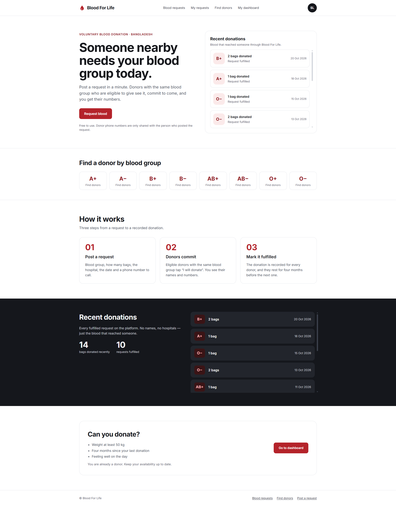
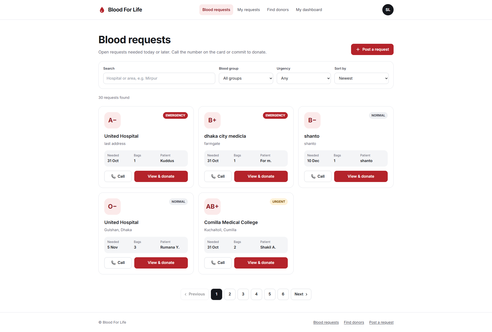
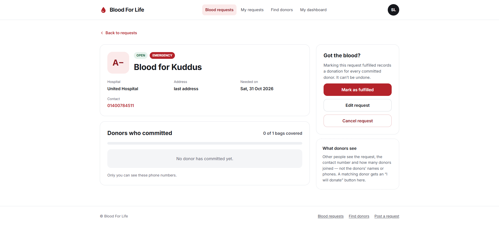
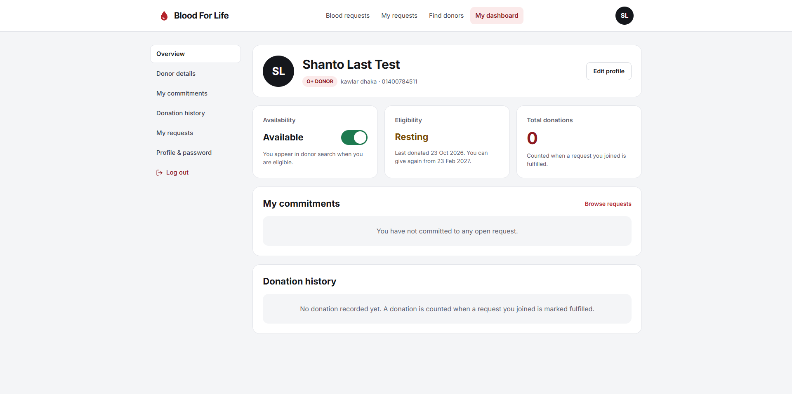
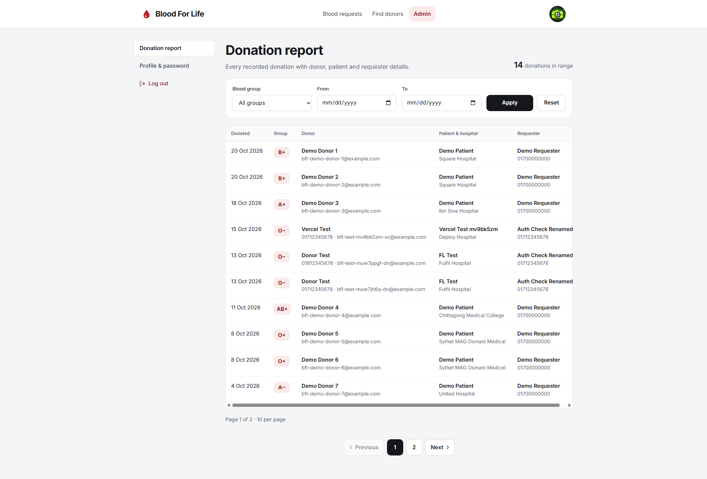

# Blood For Life — Frontend

A blood donation platform for Bangladesh. People post blood requests, donors with the same blood group commit to donate, and every fulfilled request is recorded as a donation.

**Live site:** https://client-blood-for-life.vercel.app/
**Backend API:** https://backend-blood-for-life.vercel.app
**Backend repo:** https://github.com/codexmish/Backend-Blood-For-Life



---

## Features

### For everyone
- Home page with recent donations, find donors by blood group and how it works
- Sign up with email OTP verification (6-digit code, resend after 1 minute)
- Sign in, forgot password and reset password with an email code

### For signed in users
- **Blood requests feed:** search by hospital or area, filter by blood group and urgency, sort by newest, needed soonest or most bags, with pagination
- **Post a request:** blood group, bags, hospital, address, date, contact phone, urgency and note
- **Request details:** see how many donors joined; the requester sees each donor's name and phone
- **My requests:** edit an open request, mark it fulfilled or cancel it
- **Find donors:** only available and eligible donors, filter by blood group, search by name or area
- **Profile:** update name, phone, address and photo, change password

### For donors
- **Become a donor** from a recipient account (phone and address required)
- **"I will donate"** on matching requests, and step back any time
- **Donor dashboard:** availability on/off, eligibility (4 months after the last donation), total donations, open commitments and donation history
- **Donor details:** weight, last donation date and health note

### For admins
- **Donation report:** every recorded donation with donor, patient and requester details, filter by blood group and date range

---

## Tech stack

| Area | Tools |
|---|---|
| Framework | Next.js 16 (App Router, Cache Components, React Compiler), React 19 |
| Language | TypeScript |
| Styling | Tailwind CSS 4, shadcn/ui (Base UI), lucide-react icons |
| Server state | TanStack Query 5 |
| Forms | TanStack Form + Zod 4 validation |
| HTTP | ofetch |
| Code quality | Biome (format + lint) |

---

## How it works

### Authentication
- The backend sends `accessToken` and `refreshToken` as **httpOnly cookies**, so JavaScript never touches the tokens.
- All API calls go to `/api/v1/*` on the frontend's own domain. A **Next.js rewrite** forwards them to the backend. Because of this, the cookies belong to the frontend's domain (first-party), so browsers that block third-party cookies (Safari, Firefox, incognito) still keep users signed in.
- **`proxy.ts`** runs on the server before a page renders:
  - not signed in → pages like dashboard, requests and donors redirect to `/signin`
  - signed in → `/signin` and `/signup` redirect to the home page
- The backend still checks every request, and role checks (donor, admin) happen on the backend and inside the pages.

### Data fetching
- Every API call has its own TanStack Query hook (`useBloodRequests`, `useDonors`, `useGetMe` ...).
- After a change (post, edit, donate, fulfil), the related queries are invalidated, so every screen shows fresh data without a reload.
- Lists keep the previous page on screen while the next one loads, and the search box is debounced (500 ms).

---

## Project structure

```
src/
├── app/
│   ├── (public)/
│   │   ├── (auth)/        signin, signup, otp-verify, forgot-password, reset-password
│   │   └── (marketing)/   home, blood-request, create-request, my-requests, donors, become-donor
│   └── (dashboard)/
│       └── dashboard/     overview, profile, donor-details, admin
├── api/                   one file per backend module (auth, user, donor, blood request, donation, admin)
├── hooks/                 TanStack Query hooks for every API
├── components/
│   ├── form/              all forms (TanStack Form)
│   ├── layout/            navbar, footer
│   ├── modules/           page sections (home, blood request, donor, dashboard, admin)
│   └── ui/                shadcn/ui components
├── validation/            Zod schemas (same rules as the backend)
├── types/                 TypeScript types for API data
├── utils/                 shared helpers (blood group labels, dates, error message)
├── lib/                   ofetch client
├── providers/             TanStack Query provider
└── proxy.ts               login redirects
```

---

## Getting started

### Requirements
- Node.js 20 or later
- The backend running (or use the live backend)

### Setup

```bash
git clone https://github.com/codexmish/Client-Blood-For-Life.git
cd Client-Blood-For-Life
npm install
```

Create a `.env` file in the root:

```env
NEXT_PUBLIC_BASE_URL=/api/v1
```

The backend address is set in `next.config.ts` (the `/api/v1` rewrite). Change it there if you run your own backend.

Start the dev server:

```bash
npm run dev
```

Open http://localhost:3000.

### Scripts

| Command | What it does |
|---|---|
| `npm run dev` | Start the dev server |
| `npm run build` | Build for production |
| `npm run start` | Run the production build |
| `npm run lint:check` | Check code with Biome |
| `npm run lint:fix` | Fix lint issues with Biome |
| `npm run format:fix` | Format code with Biome |

---

## Screenshots

| Blood requests | Request details |
|---|---|
|  |  |

| Donor dashboard | Admin report |
|---|---|
|  |  |

---

## Coming in v2

- Automatic token refresh, so users stay signed in for 7 days
- Notifications when a donor commits or a request is fulfilled
- Full admin panel: manage users, block accounts, remove requests
- Request history (fulfilled and cancelled requests)

---

## Author

**Majharul Islam Shanto**
- GitHub: [@codexmish](https://github.com/codexmish)
- LinkedIn: https://www.linkedin.com/in/majharulislamshanto/